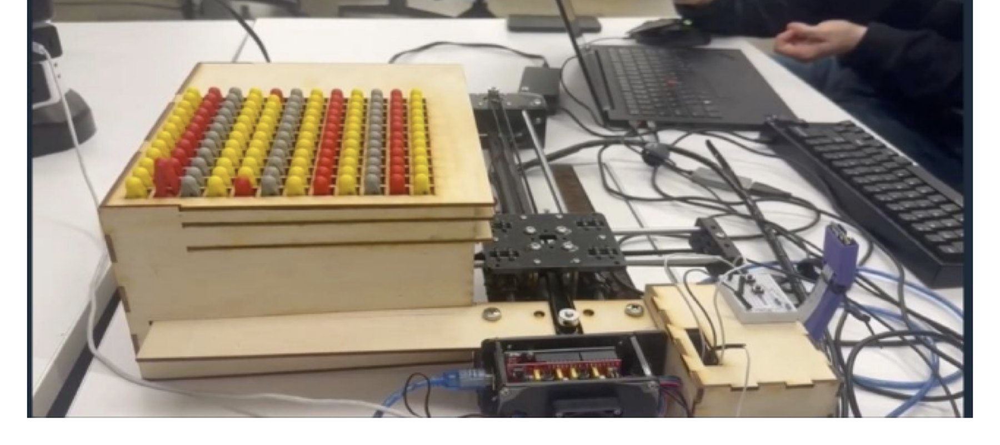
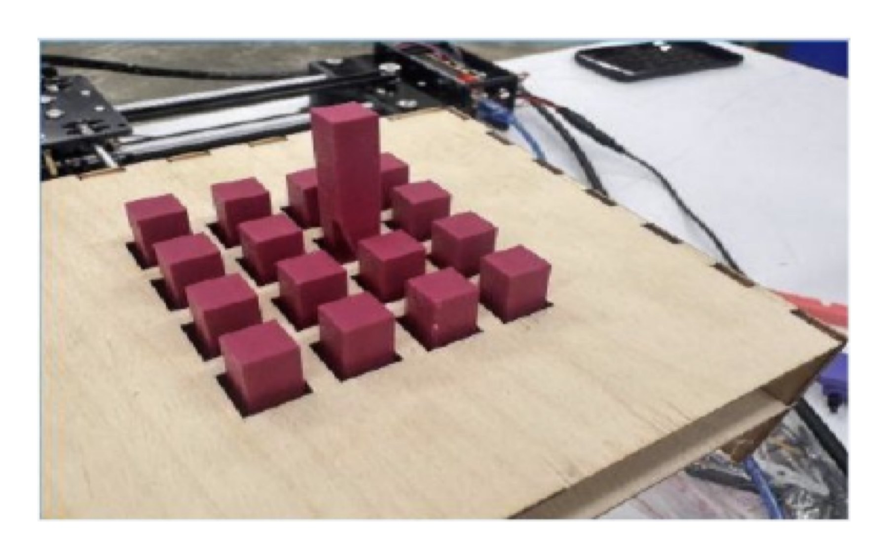
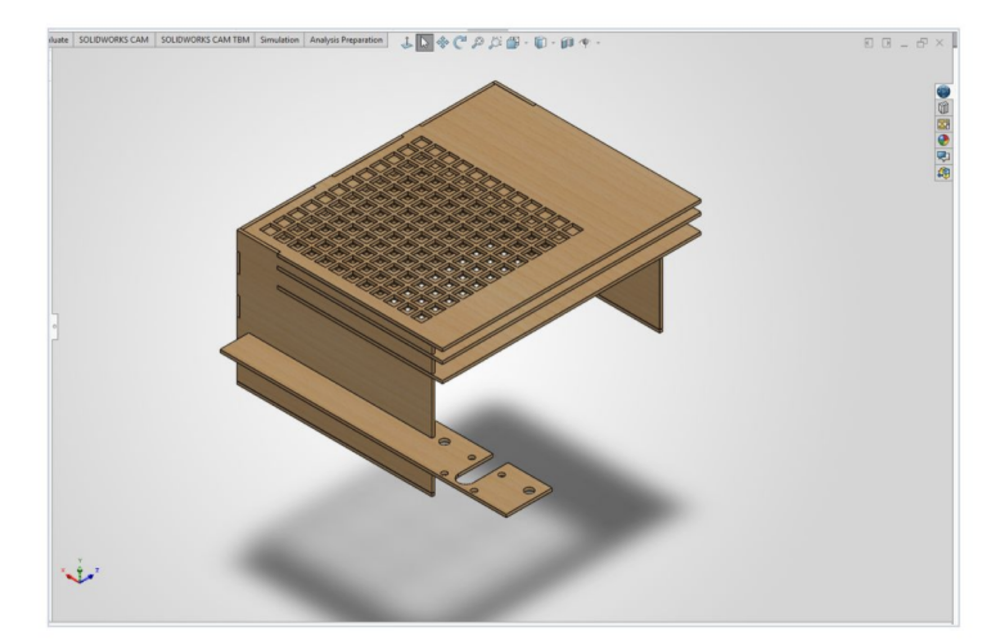
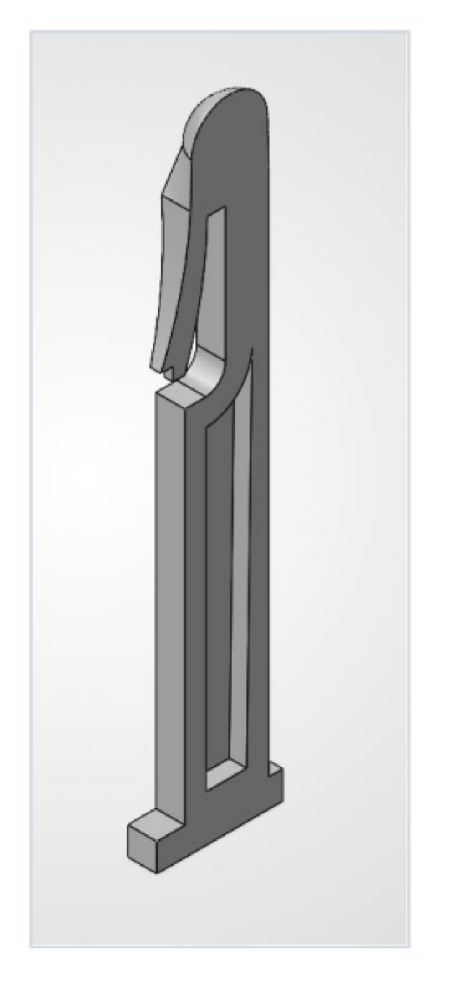
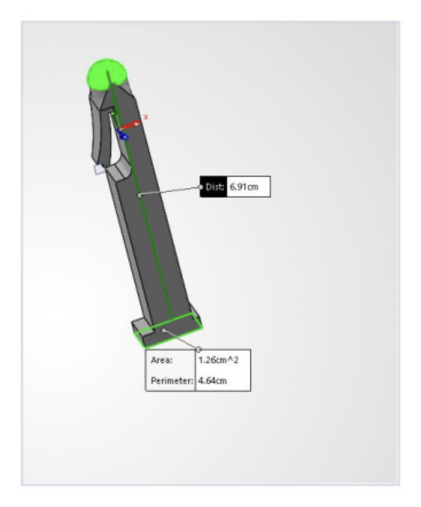

# V-Aid: tactile climbing interface

Reduced roughly 60% early pin-rise failure to smooth locking across 14 route patterns by iterating pin mass, guide geometry, and clamp behavior through four prototypes.

## My contribution

Pin CAD, guide-feature and clamp-interface iteration, FDM prototype fabrication, laser-cut housing integration, and functional route testing.

The 12 × 12 tactile array turns a climbing-route layout into raised pins. My mechanical work covered the pin profile, guides and clamp, printed prototypes, laser-cut housing and integration.

## Design iterations

Early pins caught or failed to rise. Revising the hollow pin, guide and clamp together reduced the lift load and improved locking. The retained portfolio records four prototypes and successful locking across 14 demonstrated patterns. These are functional demonstrations; repeated-cycle durability and measured actuation force were not established.

## CAD and build record

[Full case study](https://www.mergenulziibayar.com/projects/v-aid-climbing) · [Portfolio](https://www.mergenulziibayar.com)

## Record scope

This repository publishes the existing project photographs and CAD renders. [Image sources and hashes](sources.json) preserve their provenance. CAD renders are illustrations of the design record; native CAD files are not included. No new experiment was performed for this publication.
